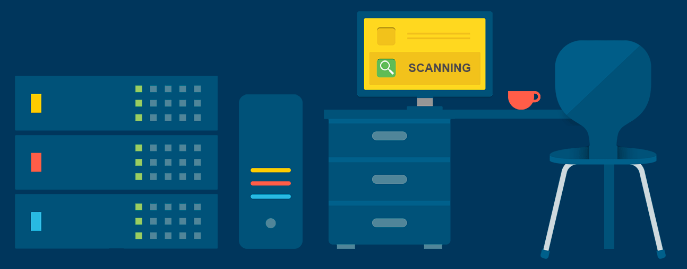
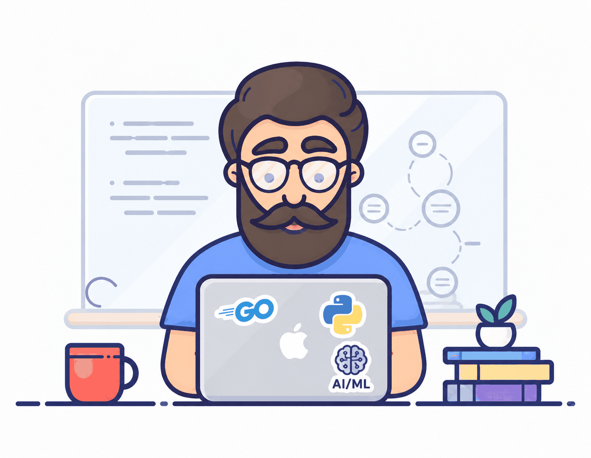

<!--  -->
<h1 align="center">Hi, I'm MD SOYAIB RAHMAN</h1>
<h3 align="center">Backend Engineer @Gigalogy • Go (Golang), Python • Scalable System, RAG, ML • ICPC Dhaka Regional</h3>

<!-- 
  
 -->

<!--
  
-->

- I’m currently working on **Backend Stuffs, System Design, AI/ML**

- I sometimes write articles on [Medium](https://medium.com/@soyaibzihad10), [The Roar](https://www.theroar.com.au/author/soyaibzihad101406/)

- Ask me about **SWE, GO, Sports, Physics**

- How to reach me **soyaibzihad10@gmail.com**

- Fun fact: **I can fix my code, but not my coffee addiction!**
